<div align="center">

# Gestão de Demandas

### Do backlog à entrega. Cada etapa visível, cada decisão registrada.

**Demandas · Scrum · Kanban · Fornecedores · Horas · Análises**

## 🌐 [ABRIR A APLICAÇÃO → os-manager-phi.vercel.app](https://os-manager-phi.vercel.app)

[](https://os-manager-phi.vercel.app)
[](https://os-manager-api.onrender.com/api/docs)
[](#-comece-em-poucos-passos)

<br>

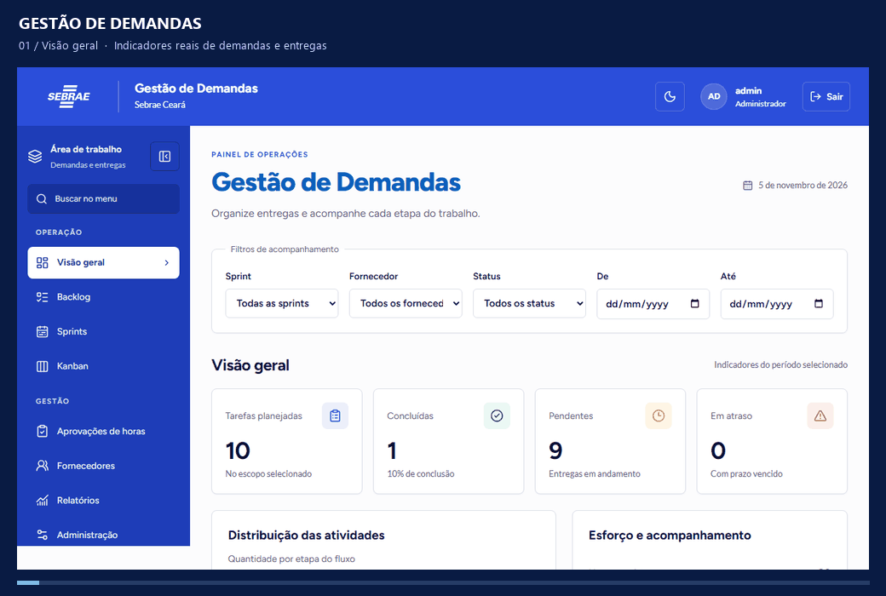

<sub>Tour animado feito com capturas reais da aplicação em testes locais. Dados inteiramente fictícios. [Ver as imagens estáticas](#-por-dentro-da-aplicação).</sub>

<br><br>


**[Conheça](#-o-que-você-pode-fazer) · [Explore as telas](#-por-dentro-da-aplicação) · [Instale](#-comece-em-poucos-passos) · [Teste](#-qualidade-verificada) · [Consulte os guias](#-mapa-da-documentação)**

</div>

---

> [!IMPORTANT]
> **O ambiente publicado é uma demonstração para testes.** O backend usa Render Free com SQLite descartável: dados, anexos e sessões podem desaparecer em reinícios, suspensão ou novos deploys. Utilize apenas dados fictícios. A primeira resposta pode demorar quando o serviço estiver suspenso.

## ✦ Uma visão compartilhada do trabalho

Gestão de Demandas reúne planejamento, execução e acompanhamento em uma aplicação web em português. A equipe organiza o backlog, personaliza cada card, planeja sprints e acompanha o Kanban. O fornecedor acessa suas atividades e informa horas; o gestor autorizado revisa os apontamentos e acompanha as entregas.

Os relatórios conectam esse fluxo ao histórico: **quanto tempo um card passou em cada fase, quando foi movimentado, quantos ciclos teve e como a sprint evoluiu**. Informações financeiras seguem permissões específicas no servidor.

A experiência visual segue a referência Sebrae Ceará fornecida para o projeto: identidade institucional, fontes locais, temas claro e escuro e navegação adaptada ao celular.

## 🧭 O que você pode fazer

| Planejar | Executar | Entender |
| :--- | :--- | :--- |
| **Backlog organizado** — busca, prioridade, prazo e responsáveis | **Kanban persistente** — arrastar cards ou mover pelo menu | **Tempo por fase** — permanências e passagens do card |
| **Sprints Scrum** — planejar, iniciar, encerrar e reabrir com autorização | **Cards individuais** — campos, opções e regras por atividade | **Lead time e ciclos** — criação, produção e conclusão |
| **Fornecedores** — cadastro individual e tarifas versionadas | **Horas e aprovação** — envio, rejeição, correção e decisão registrada | **Sprint e backlog** — compromisso, entregas, devoluções e idade |
| **Permissões granulares** — papel e concessões explícitas | **Comentários e anexos** — colaboração vinculada à tarefa | **Relatórios filtráveis** — campos do card, exceto descrição, e exportações XLSX/PDF |

### Um fluxo, diferentes responsabilidades

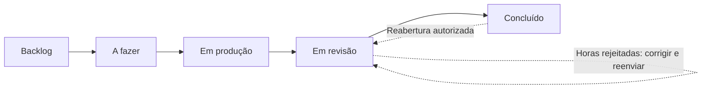

- **Quem cria o card** escolhe incluir horas previstas e se a resposta será obrigatória.
- **O fornecedor responsável** informa as horas; horas utilizadas positivas são exigidas para revisão.
- **O gestor com `approve_hours`** aprova ou rejeita a versão enviada. Somente gestor conclui, após aprovação.
- **O backend** valida escopo, transição, campos e versão antes de persistir qualquer alteração.

## 📸 Por dentro da aplicação

<details open>
<summary><strong>01 · Visão geral — indicadores para acompanhar as entregas</strong></summary>

<br>

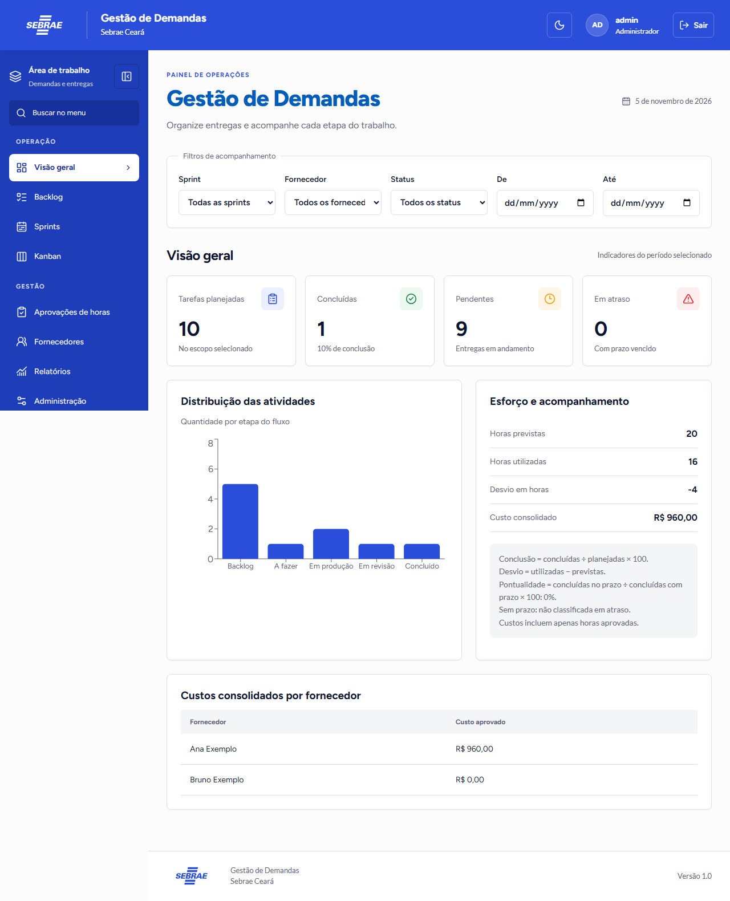

Filtros por sprint, fornecedor, status e período. Os indicadores vêm do banco; custos aparecem somente para quem tem autorização financeira.

</details>

<details>
<summary><strong>02 · Kanban — trabalho visível em cada fase</strong></summary>

<br>

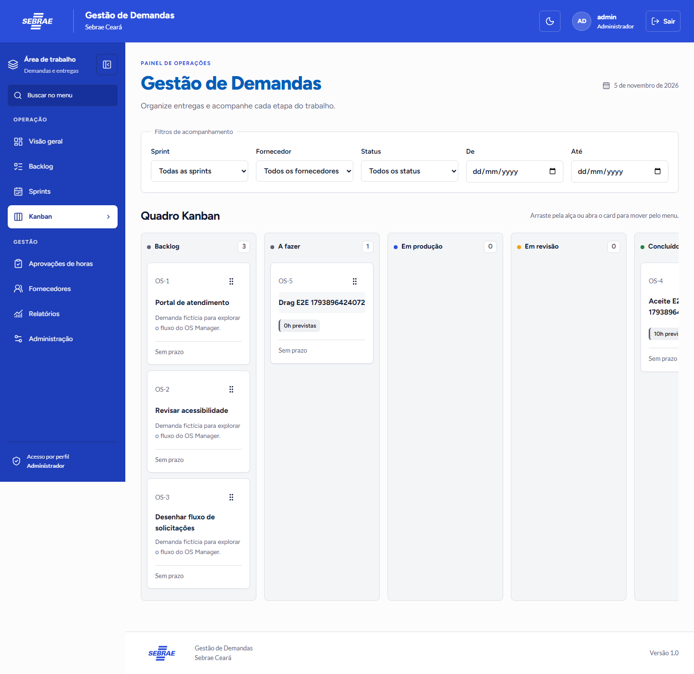

Drag and drop com persistência e alternativa por menu. Uma transição recusada mantém o card na origem; pendências de horas recebem aviso vermelho em modal sobreposto.

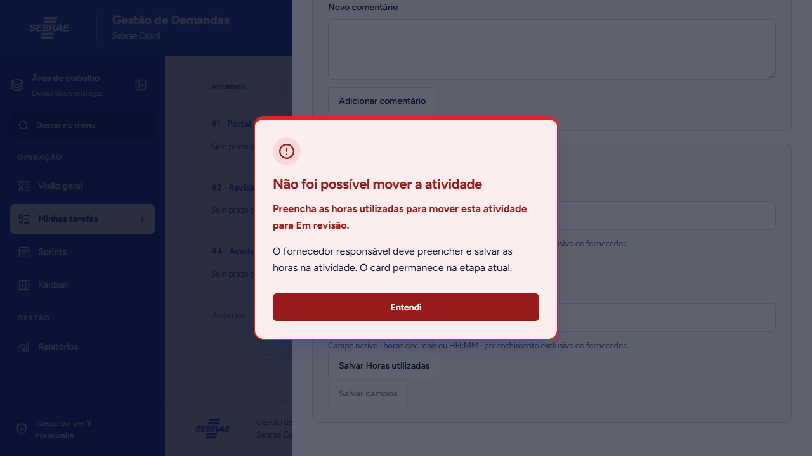

</details>

<details>
<summary><strong>03 · Relatórios — do filtro ao histórico do card</strong></summary>

<br>

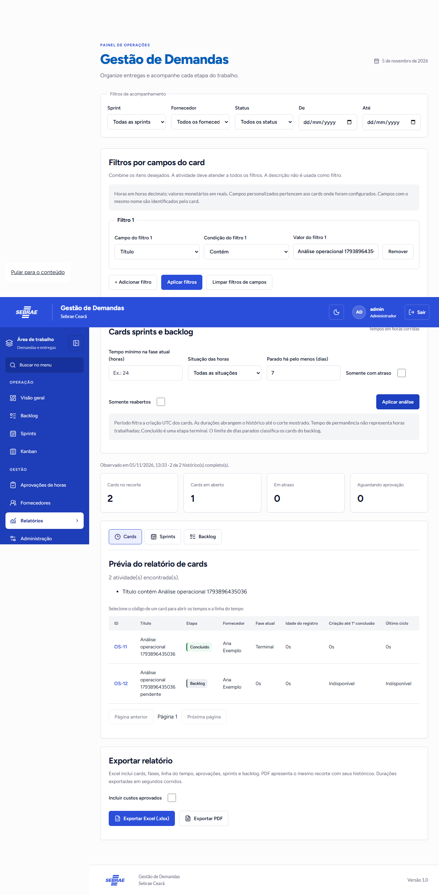

Combine os campos disponíveis no card, exceto descrição. Explore as abas **Cards**, **Sprints** e **Backlog**, abra o detalhe e exporte o mesmo recorte.

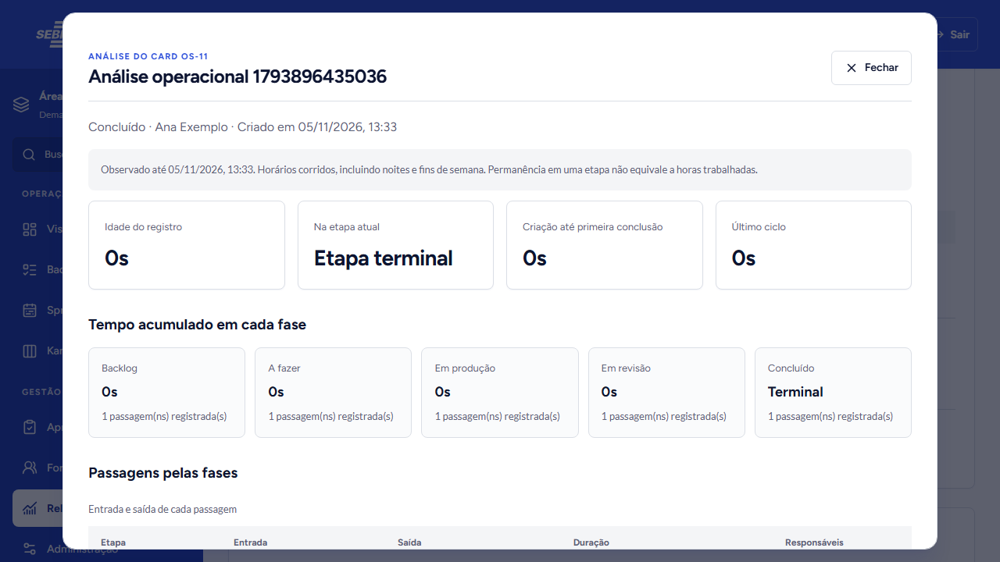

> Capturas de testes automatizados podem mostrar tempos de poucos segundos e títulos técnicos. Tempos de permanência são corridos; não equivalem a horas trabalhadas. Históricos incompletos são identificados como indisponíveis.

</details>

<details>
<summary><strong>04 · Tema escuro — preferência visual persistida</strong></summary>

<br>

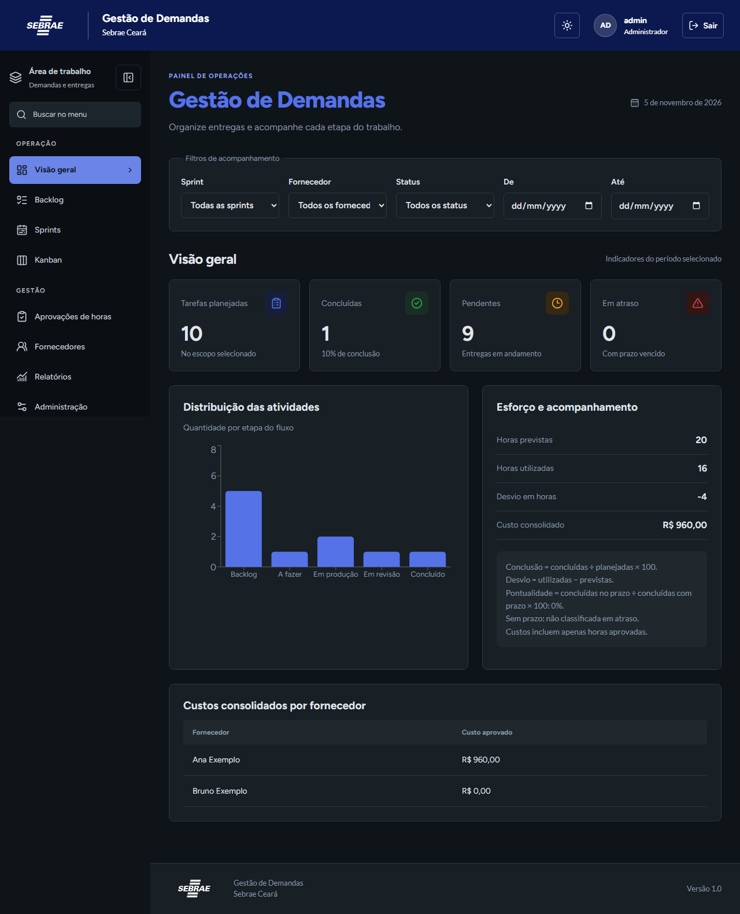

O usuário escolhe o tema; a preferência fica salva no navegador. As fontes são servidas pelo próprio projeto.

</details>

<details>
<summary><strong>05 · No celular — a mesma operação em uma navegação adaptada</strong></summary>

<br>

<p align="center">
  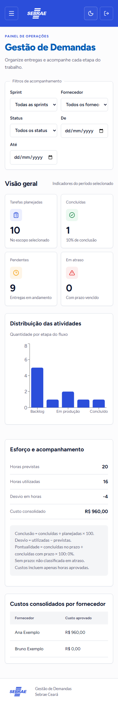
  &nbsp;&nbsp;
  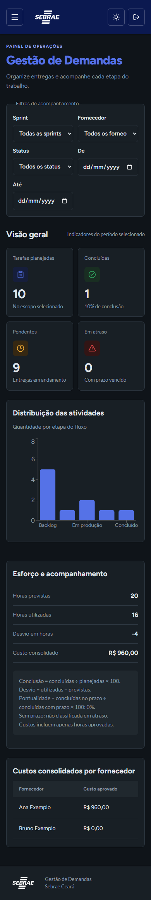
</p>

Menu móvel com fechamento por Escape, foco contido e retorno ao controle de origem. Quadros e tabelas mantêm rolagem quando necessária.

</details>

## 🚀 Comece em poucos passos

**Requisitos locais:** Python **3.12+**, Node.js **22.12+**, npm e Git. O desenvolvimento usa SQLite em arquivo: não exige servidor de banco, conta em nuvem ou serviço pago. A instalação inicial precisa de internet para baixar dependências.

### 1. Obtenha a versão desta atualização

```powershell
git clone --branch atualizacao-os-manager https://github.com/PedroGiffoni/OS_Manager.git
cd OS_Manager
```

### 2. Prepare o ambiente com dados fictícios

```powershell
.\scripts\Setup-Local.ps1 -Demo
```

### 3. Inicie em dois terminais PowerShell

```powershell
# Terminal 1 — API
.\scripts\Start-Backend.ps1
```

```powershell
# Terminal 2 — interface
.\scripts\Start-Frontend.ps1
```

| Serviço | Endereço local |
| :--- | :--- |
| **Aplicação** | [127.0.0.1:5173](http://127.0.0.1:5173) |
| **API interativa / Swagger** | [127.0.0.1:8000/api/docs](http://127.0.0.1:8000/api/docs) |
| **OpenAPI JSON** | [127.0.0.1:8000/api/openapi.json](http://127.0.0.1:8000/api/openapi.json) |
| **Health check** | [127.0.0.1:8000/api/v1/health](http://127.0.0.1:8000/api/v1/health) |

<details>
<summary><strong>Instalação manual / política de scripts restrita</strong></summary>

Não é necessário alterar a política global de execução do Windows. Na raiz do repositório:

```powershell
python -m venv .venv
.venv/Scripts/python.exe -m pip install -r backend/requirements.lock.txt
cd backend
../.venv/Scripts/python.exe -m alembic upgrade head
$env:OS_MANAGER_ALLOW_DEMO_SEED='true'
../.venv/Scripts/python.exe -m app.seed
Remove-Item Env:OS_MANAGER_ALLOW_DEMO_SEED
../.venv/Scripts/python.exe -m uvicorn app.main:app --host 127.0.0.1 --port 8000 --no-access-log
```

Em outro terminal, na raiz:

```powershell
cd frontend
npm.cmd ci
npm.cmd run dev
```

Em Linux/macOS, substitua os executáveis do virtualenv por `.venv/bin/python` e `npm.cmd` por `npm`; exporte as variáveis com a sintaxe do seu shell. Os scripts `.ps1` são para PowerShell.

</details>

## 🔑 Explore com contas de demonstração

**Somente no ambiente local**, a senha padrão do seed é `DemoLocal!2026`.

| Usuário | Experiência disponível |
| :--- | :--- |
| `admin` | Administração e todas as permissões |
| `gestor` | Demandas, sprints, fornecedores/tarifas, aprovação e acesso financeiro |
| `gestor_sem_aprovacao` | Gestão operacional; sem aprovação de horas e sem finanças |
| `interno` | Criação de tarefas, configuração de cards, sprints e exportações operacionais |
| `fornecedor` | Ana Exemplo: tarefas próprias, horas e exportação do próprio escopo |
| `fornecedor2` | Bruno Exemplo: mesmo isolamento, sem acesso às tarefas de Ana |

> [!NOTE]
> **No site publicado, a senha é privada e diferente da senha local.** O responsável pelo ambiente pode consultá-la na variável `OS_MANAGER_DEMO_PASSWORD` no [painel do Render](https://dashboard.render.com/web/srv-db8irum89jmc73dttfl0/env). Não publique esse valor no repositório.

O seed exige `OS_MANAGER_ALLOW_DEMO_SEED=true` e recusa modificar um banco que já tenha usuários. As contas, tarifas e demandas são fictícias; não são credenciais de produção.

## 🎬 Experimente o fluxo completo

1. **Prepare a equipe.** Entre como `admin` ou `gestor`; consulte o fornecedor fictício e sua tarifa.
2. **Crie a demanda.** No Backlog, atribua o fornecedor. Em horas previstas, escolha não incluir, incluir como opcional ou exigir resposta. Salvar o card sem estimativa é permitido.
3. **Personalize.** Abra o construtor individual, adicione campos, configure opções, ordem e obrigatoriedade por etapa; salve a configuração.
4. **Planeje a sprint.** Crie uma sprint, inclua o card e inicie. O vínculo leva a atividade a A fazer.
5. **Execute como fornecedor.** Entre como `fornecedor`. Se a estimativa foi configurada como obrigatória, informe-a antes da produção. Informe o total utilizado antes de enviar à revisão.
6. **Revise como gestor.** Rejeite com justificativa, veja a sinalização ao fornecedor e faça uma nova submissão. Aprove como gestor autorizado e conclua o card.
7. **Analise.** Em Relatórios, filtre a atividade, consulte fases/ciclos, abra o histórico e exporte Excel/PDF. Custos dependem das permissões financeiras.
8. **Feche o ciclo.** Encerre a sprint com outra tarefa pendente: ela volta ao backlog, preservando horas, configuração e histórico da sprint encerrada.

### Uma regra financeira que preserva o passado

```text
Tarifa na alocação       R$ 120,00/h
Reajuste posterior      R$ 150,00/h
Horas utilizadas        8 horas aprovadas
Custo consolidado       8 × R$ 120,00 = R$ 960,00
```

A alocação guarda a tarifa vigente naquele momento. Reajustes não reescrevem custos históricos. Horas previstas são planejamento; horas não aprovadas não entram no total consolidado. Dinheiro é armazenado em centavos e horas em minutos; o cálculo usa `Decimal` e arredondamento `ROUND_HALF_UP`.

## 🏗️ Como o projeto se organiza

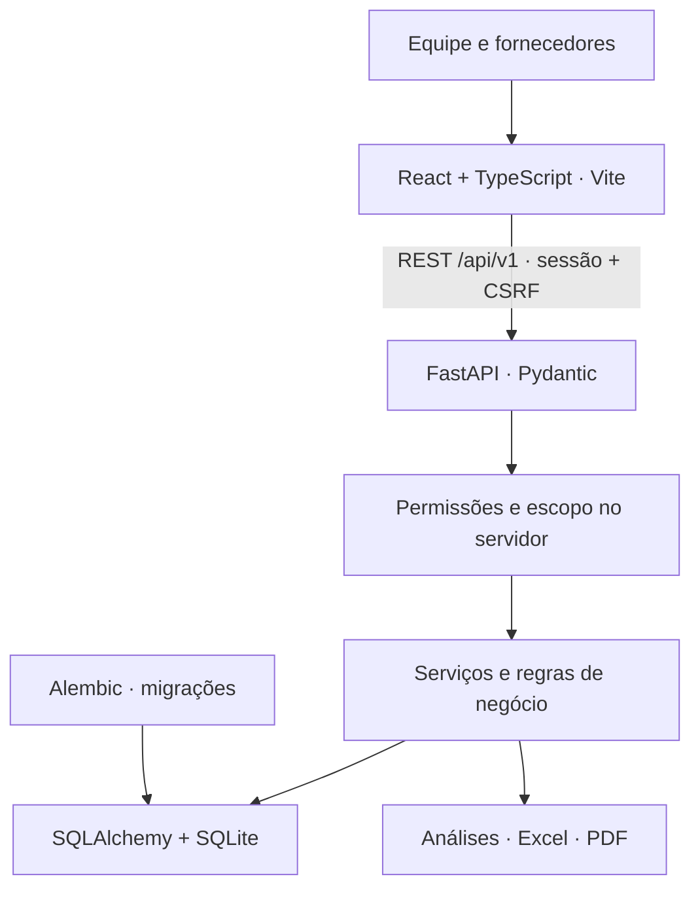

| Camada | Tecnologias e responsabilidade |
| :--- | :--- |
| **Interface** | React 19, TypeScript, Vite, React Router, TanStack Query |
| **Interação** | React Hook Form + Zod, dnd-kit, Recharts, Lucide, CSS com tokens semânticos |
| **Backend** | FastAPI, Pydantic, serviços, repositórios e persistência SQLAlchemy |
| **Dados** | SQLite local, Alembic, integridade referencial e versões de concorrência |
| **Verificação** | pytest, Vitest/Testing Library, Playwright, Ruff, ESLint, Prettier |
| **Publicação de testes** | Vercel no frontend; Render Free no backend; Compose opcional local |

```text
OS_Manager/
├── backend/
│   ├── app/              # API, segurança, regras, persistência e análises
│   ├── migrations/       # Evolução do esquema via Alembic
│   ├── tests/            # Regras, API, autorização e integridade
│   └── requirements.lock.txt
├── frontend/
│   ├── src/              # Páginas, componentes, temas e testes
│   ├── public/marca/     # Identidade visual
│   └── e2e/              # Fluxos de navegador
├── docs/
│   └── media/            # Prints reais e tour animado deste README
├── scripts/              # Setup, inicialização e runner de testes
├── docker-compose.yml
└── render.yaml
```

### Segurança e integridade

Sessões usam cookie **HttpOnly**, com `Secure` em HTTPS; mutações exigem proteção CSRF. Autorização e isolamento de fornecedores são aplicados na API, inclusive nos detalhes por ID, anexos e exportações. Tarifas e custos não são enviados ao fornecedor. Configurações de card, transições, decisões de horas e mudanças relevantes têm trilha de auditoria.

Papel e permissão são distintos: um gestor sem concessão explícita não aprova horas nem acessa finanças. Conflitos de versão exigem recarregar antes de tentar novamente. Consulte a [matriz de permissões](docs/PERMISSIONS.md) e as [decisões de negócio](docs/DECISIONS.md).

## ⚙️ Configuração e banco local

| Variável | Padrão / finalidade |
| :--- | :--- |
| `DATABASE_URL` | `sqlite:///./data/os_manager.db` |
| `COOKIE_SECURE` | `false` em HTTP local; `true` em HTTPS |
| `APP_TIMEZONE` | `America/Sao_Paulo` para apresentação |
| `TRUSTED_ORIGINS` | Origens frontend autorizadas; ver `.env.example` |
| `OS_MANAGER_ALLOW_DEMO_SEED` | Opt-in explícito para dados fictícios |
| `OS_MANAGER_DEMO_PASSWORD` | Senha privada obrigatória no seed de nuvem |
| `CLOUD_DEPLOYMENT` | Ativa exigências da configuração de nuvem |

O caminho do SQLite é relativo ao diretório onde o backend é executado. Nos comandos locais acima, o arquivo fica em **`backend/data/os_manager.db`**, fora do Git. O diretório é criado automaticamente; a estrutura do banco é aplicada por migrações Alembic.

As variáveis devem ser definidas no ambiente do processo. O Python não carrega `.env` implicitamente; o arquivo de exemplo documenta a configuração. Nunca versione senhas, tokens, banco ou anexos locais.

> [!IMPORTANT]
> SQLite atende ao protótipo e aos testes locais. A implantação institucional exige avaliação de banco, segurança, concorrência e homologação pela TI. A troca futura de SGBD não é automática: siga o [roteiro de migração e rollback](docs/DATABASE_MIGRATION.md).

<details>
<summary><strong>🐳 Alternativa: Docker Compose</strong></summary>

Com Docker Desktop em modo Linux e daemon ativo:

```powershell
docker compose up --build
```

Para criar os dados fictícios em um banco vazio:

```powershell
docker compose exec -e OS_MANAGER_ALLOW_DEMO_SEED=true backend python -m app.seed
```

Acesse **[localhost:8080](http://localhost:8080)**. O volume `sqlite-data` preserva banco e anexos. Não execute `docker compose down -v` se quiser manter esses dados.

**Estado de validação:** arquivos e health checks fornecidos; Docker Compose local não foi homologado neste ambiente porque o daemon estava indisponível. O build Docker do backend foi executado no Render. Veja [limitações conhecidas](docs/KNOWN_LIMITATIONS.md).

</details>

## ✅ Qualidade verificada

**Última rodada local executada: 05/11/2026**, antes da publicação da atualização `488c25a`.

| Verificação | Resultado registrado |
| :--- | :--- |
| Backend · pytest | **50 testes aprovados** |
| Frontend · Vitest | **5 testes aprovados** |
| Navegador · Playwright | **8 fluxos aprovados** |
| Build e TypeScript | Aprovados |
| Ruff, ESLint e formatação | Aprovados |
| Publicação da atualização | Vercel `READY` e Render `live`, no mesmo commit |
| Verificação pública | Site, bundle e health HTTP 200; nova API protegida retorna 401 sem sessão |

<sub>Resultados datados, não badges de CI em tempo real. Os oito E2E desta rodada foram locais, com banco temporário. A suíte Python emitiu um aviso de depreciação Starlette/httpx.</sub>

<details>
<summary><strong>Reproduzir testes e verificações</strong></summary>

```powershell
# A partir da raiz
cd backend
../.venv/Scripts/python.exe -m pytest -q
../.venv/Scripts/python.exe -m ruff check app tests
../.venv/Scripts/python.exe -m ruff format --check app tests
cd ../frontend
npm.cmd run test
npm.cmd run lint
npm.cmd run typecheck
npm.cmd run build
npm.cmd run format:check
```

Instale o Chromium uma vez e execute o runner isolado:

```powershell
# Na pasta frontend
npx.cmd playwright install chromium
cd ..
.venv/Scripts/python.exe scripts/run_e2e.py
```

O runner cria SQLite temporário, aplica migrações, executa seed e usa API em **8001** e Vite em **5174**. Não altera o banco de desenvolvimento.

Para revisar dependências:

```powershell
# Em frontend
npm.cmd audit
# Na raiz, com pip-audit instalado no virtualenv
.venv/Scripts/python.exe -m pip_audit --local
```

Não há declaração de auditoria limpa: foi identificada vulnerabilidade alta preexistente no Zod 3.24.3, cuja correção requer avaliar a migração para Zod 4. Consulte [o registro da atualização](docs/DESIGN_UPDATE.md).

</details>

## 📚 Mapa da documentação

| Quero entender… | Documento |
| :--- | :--- |
| Arquitetura e organização | [ARCHITECTURE.md](docs/ARCHITECTURE.md) |
| Papéis, permissões e escopo | [PERMISSIONS.md](docs/PERMISSIONS.md) |
| Decisões e regras adotadas | [DECISIONS.md](docs/DECISIONS.md) |
| Endpoints e contratos | [API.md](docs/API.md) · [OpenAPI online](https://os-manager-api.onrender.com/api/docs) |
| Fórmulas de indicadores | [METRICS.md](docs/METRICS.md) |
| Filtros de campos do card | [REPORT_FILTERS.md](docs/REPORT_FILTERS.md) |
| Tempos, ciclos, sprint e backlog | [OPERATIONAL_ANALYTICS.md](docs/OPERATIONAL_ANALYTICS.md) |
| Identidade visual e acessibilidade | [DESIGN_UPDATE.md](docs/DESIGN_UPDATE.md) |
| Deploy e configuração de nuvem | [DEPLOYMENT.md](docs/DEPLOYMENT.md) |
| Registros anteriores de publicação | [DEPLOYMENT_STATUS.md](docs/DEPLOYMENT_STATUS.md) |
| Evolução futura do banco | [DATABASE_MIGRATION.md](docs/DATABASE_MIGRATION.md) |
| Validação e limites do protótipo | [VALIDATION.md](docs/VALIDATION.md) · [KNOWN_LIMITATIONS.md](docs/KNOWN_LIMITATIONS.md) |

## 🛠️ Estado atual e próximos cuidados

- [x] Persistência, autenticação e permissões no backend.
- [x] Backlog, sprints, Kanban, cards individuais e colaboração.
- [x] Horas previstas configuráveis; horas utilizadas, aprovação e custo histórico.
- [x] Relatórios com filtros, análise operacional e exportações reais.
- [x] Interface responsiva com temas claro/escuro e publicação de testes.
- [ ] Homologar infraestrutura, banco e políticas para uso institucional.
- [ ] Validar carga, volumes maiores e paginação dos seletores/quadros.
- [ ] Avaliar atualização de dependências e medidas institucionais como SSO/MFA.
- [ ] Evoluir previsões, percentis e burndown avançado após validação de escopo.

Retornos de etapa seguem uma matriz conservadora; troca de fornecedor em execução é bloqueada para preservar o histórico. Não há avaliação subjetiva de produtividade nem integrações corporativas externas nesta versão. Os limites completos estão documentados, sem promessa de prontidão institucional.

---

<div align="center">

### Planeje com clareza. Acompanhe com contexto. Entregue com histórico.

**[🌐 Acessar Gestão de Demandas](https://os-manager-phi.vercel.app)** &nbsp;·&nbsp; **[Código no GitHub](https://github.com/PedroGiffoni/OS_Manager/tree/atualizacao-os-manager)** &nbsp;·&nbsp; **[Voltar ao início ↑](#gestão-de-demandas)**

<sub>Projeto anteriormente denominado OS Manager. Identificadores técnicos do repositório e da infraestrutura foram preservados.</sub>

</div>
